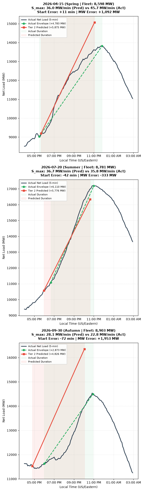

# ISO-NE Net Load Evening Ramp Forecasting

An operational machine learning pipeline to forecast the 4-dimensional envelope of the evening "duck curve" net load ramp in ISO New England at a strict 12:00 PM operational decision gate.



*Figure 1: Out-of-sample prediction on the 2026 holdout set. The shaded blue region denotes the predicted ramp envelope (start time, duration, and capacity) compared against the actual 5-minute telemetry (solid black) and morning reference trajectory.*

---

## Executive Summary

As distributed solar penetration expands across ISO New England, behind-the-meter (BTM) generation masks true midday consumer demand, creating deep afternoon net load troughs. When the sun sets, two phenomena occur simultaneously:
1. Solar generation collapses over a 2–3 hour window.
2. System-wide electricity demand surges toward its evening lighting and appliance peak.

This dynamic produces a steep, non-linear **evening net load ramp** requiring thousands in additional megawatts of capacity. Grid operators must commit generation and schedule battery storage hours before the ramp begins. 

This project provides an operational forecasting engine that predicts the geometry of the evening ramp at **12:00 PM local time**, evaluating multiple machine learning architectures under asymmetric risk constraints.

---

## The Operational Decision Gate

### Why 12:00 PM?
Grid control rooms cannot wait until the ramp starts to react. Fast-start peaking units and intermediate combined-cycle plants have startup notification times of 2 to 4 hours. Battery energy storage systems (BESS) must also allocate state-of-charge during the midday solar trough. 

A strict cutoff at **12:00 PM Eastern** balances two competing needs:
- **Actionable lead time**: Delivers forecasts 4 to 6 hours ahead of the evening peak.
- **Data availability**: Incorporates complete morning load telemetry, observed morning cloud cover, and midday NOAA HRRR numerical weather predictions.

### Screening Filter (Morning Solar Penetration Gate)
Not every day exhibits duck curve dynamics. Overcast or stormy winter days have little solar generation and follow standard seasonal demand curves. The pipeline applies a screening gate at noon:

$$\text{Solar Penetration}_{\text{AM}} = \frac{\text{Estimated Solar Generation}}{\text{Gross Demand}} \ge 20\%$$

Days meeting this criterion enter the ramp forecasting pipeline; non-qualifying days are dropped from the analysis.

---

## Envelope Formulation: Why 4D Scalars?

Rather than forecasting continuous 5-minute time series curves, this system predicts a **4-dimensional parametric envelope** representing the physical boundaries of the ramp:

| Parameter | Unit | Description | Operational Significance |
| :--- | :--- | :--- | :--- |
| **$t_{\text{start}}$** | Minutes from noon | Timestamp where net load inflects and begins ramping upward | Determines operator call time and generation startup notice |
| **$\Delta \text{MW}_{\text{norm}}$** | MW normalized by total solar capacity| Total upward MW ramp from trough to evening peak | Sizes total required generation commitment |
| **$\Delta t$** | Minutes | Total duration of the upward ramp | Duration of the ramp to schedule flexible resources |
| **$S_{\text{max}}$** | MW / min | Maximum instantaneous 5-minute ramp speed | Dictates spinning reserve and fast-frequency response allocation |


## Asymmetric Quantile Loss

In power system operations, forecast errors are fundamentally asymmetric:
- **Over-forecasting ramp severity**: The grid procures more reserves than needed, incurring modest fuel and standby capacity holding costs.
- **Under-forecasting ramp severity**: The grid faces severe capacity deficits, risking emergency fast-start peaker activations ($1,000+/MWh), transmission strain, or localized shedding(in the most extreme of cases, seldom seen in the US).

To reflect this economic reality, the models are trained using **pinball loss (quantile regression)** targeting conservative percentiles:
- **$t_{\text{start}}$ ($\alpha = 0.15$)**: Biases early, ensuring operators receive advance warning.
- **$\Delta \text{MW}_{\text{norm}}$ ($\alpha = 0.85$)**: Conservative capacity sizing to avoid generation deficits.
- **$S_{\text{max}}$ ($\alpha = 0.85$)**: Conservative ramp speed protection for reserve headroom.
- **$\Delta t$ ($\alpha = 0.50$)**: Symmetric median duration estimate.

---

## Pipeline Architecture

The pipeline is organized into five numbered, reproducible notebooks:

```
notebooks/
├── 01_data_ingestion.ipynb          # Telemetry ingestion & HRRR S3 Zarr extraction
├── 02_ramp_segmentation.ipynb       # Savitzky-Golay filtering & 4D envelope extraction
├── 03_feature_engineering.ipynb     # Pre-noon weather/load features & collinearity pruning
├── 04_model_benchmarking.ipynb      # Multi-model evaluation (Baselines, LightGBM, CatBoost)
└── 05_final_testing_2026.ipynb      # Out-of-sample holdout validation on 2026 data
```

### Data Sources
1. **Grid Telemetry**: 5-minute net load, gross demand, and estimated behind-the-meter solar generation from [ISO New England](https://www.iso-ne.com/isoexpress/) via the [`gridstatusio`](https://github.com/gridstatus/gridstatusio).
2. **Numerical Weather Predictions**: NOAA High-Resolution Rapid Refresh (HRRR) forecasts extracted via chunked queries against AWS S3 Zarr archives ([`s3://hrrrzarr/`](https://registry.opendata.aws/noaa-hrrr-pds/)).
3. **Weather Observations**: Surface temperature, shortwave radiation, and cloud cover across 4 regional load and generation centroids (Boston, Worcester, Hartford, Bangor) via [Open-Meteo Historical Weather API](https://open-meteo.com/en/docs/historical-weather-api).
4. **Solar Capacity**: Annual distributed and utility solar capacity ratings compiled from official  [ISO-NE CELT Reports](https://www.iso-ne.com/system-planning/system-plans-studies/celt/) (Capacity, Energy, Loads, and Transmission).
---

## Out-of-Sample Holdout Results (2026)

The models were evaluated against an untouched **2026 out-of-sample holdout set**. Models trained with asymmetric quantile loss achieved an **82.7% reduction in capacity deficit severity** and a **61.1% reduction in ramp speed deficit severity** compared to symmetric baseline models:

| Target | Metric | Tier 0 (Linear Quantile) | Tier 1 (Symmetric MSE) | Tier 1 (LightGBM Quantile) | Tier 2 (Chained Quantile) |
| :--- | :--- | :---: | :---: | :---: | :---: |
| **$t_{\text{start}}$** | Pinball Loss | 12.82 | 13.65 | 7.40 | **7.40** |
| | Deficit (Minutes late) | 73.65 | 12.64 | 34.99 | 34.99 |
| **$\Delta \text{MW}_{\text{norm}}$** | Pinball Loss | 0.0419 | 0.0203 | **0.0173** | 0.0176 |
| | Deficit Severity | 0.0011 | 0.0181 | 0.0033 | **0.0031** |
| | MAPE | 61.7% | 10.5% | 23.0% | 23.4% |
| **$\Delta t$** | Pinball Loss | 19.93 | 13.97 | **14.74** | 14.81 |
| | MAE (Minutes) | 39.87 | 27.95 | 29.48 | 29.62 |
| **$S_{\text{max}}$** | Pinball Loss | 2.55 | 3.02 | 2.13 | **1.63** |
| | Deficit Severity | 2.25 | 3.39 | 2.06 | **1.32** |
| | MAE (MW/min) | 6.51 | 4.35 | 4.57 | 4.72 |
| **Physical Invariants** | Violation Rate | 0.0% | 0.0% | 0.0% | **0.0%** |

> **The MAPE vs. Deficit Trade-off**: Notice that while the Symmetric MSE model produces a lower standard MAPE (10.5% vs. 23.4%), it routinely under-forecasts the ramp magnitude (deficit of 0.0181). The quantile model intentionally carries positive bias to protect grid stability, cutting dangerous capacity deficit severity by over 80%.

---

## Getting Started

### Installation
Clone the repository and install dependencies in an isolated virtual environment:

```powershell
git clone https://github.com/<your-username>/energy-systems-analysis.git
cd energy-systems-analysis
python -m venv .venv
.venv\Scripts\activate
pip install -e .
```

### Reproducing the Pipeline
1. Run `notebooks/01_data_ingestion.ipynb` to verify raw data structures and loader benchmarks.
2. Run `notebooks/02_ramp_segmentation.ipynb` to inspect Savitzky-Golay envelope extraction.
3. Run `notebooks/03_feature_engineering.ipynb` to reproduce feature selection and collinearity pruning.
4. Run `notebooks/04_model_benchmarking.ipynb` to train and compare candidate models on 2021–2025 data.
5. Run `notebooks/05_final_testing_2026.ipynb` to evaluate against the 2026 holdout dataset.

---

## Repository Structure

```
├── data/
│   └── processed/             # Cleaned 5-minute telemetry and feature matrices
├── figures/
│   └── 2026_sample_output.png # Out-of-sample visual validation
├── notebooks/                 # Sequential analysis pipeline (01 through 05)
│   └── scratch/               # Exploratory scratch notebooks
├── scripts/
│   └── process_2026.py        # Automated pipeline driver for new telemetry
├── src/
│   ├── data/                  # ISO-NE, HRRR Zarr, and Open-Meteo loaders
│   └── targets/               # Savitzky-Golay ramp segmentation logic
├── pyproject.toml             # Package metadata and dependencies
└── README.md
```
